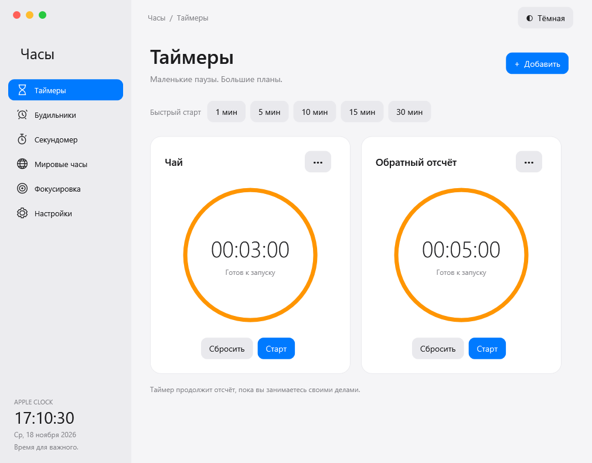

# Apple Clock — Apple Design

Часы для Windows в стиле macOS: спокойный интерфейс, оранжевые кольца таймеров, скруглённые карточки, светлая и тёмная темы. Самостоятельное настольное приложение с русским интерфейсом.



[Тёмная тема](docs/preview-dark.png) · [Будильники](docs/preview-alarms.png)

## Скачать

- **[Установщик AppleClock-Setup-1.0.8.exe](https://github.com/MaksimDenisov31/apple-clock-apple-design/releases/download/v1.0.8/AppleClock-Setup-1.0.8.exe)** — установка для текущего пользователя, меню «Пуск», необязательный ярлык рабочего стола и обычное удаление через параметры Windows.
- **[Переносная версия AppleClock-Portable-1.0.8.zip](https://github.com/MaksimDenisov31/apple-clock-apple-design/releases/download/v1.0.8/AppleClock-Portable-1.0.8.zip)** — распакуйте всю папку и запустите `AppleClock.exe`. Установка не нужна.
- [Все выпуски и контрольные суммы](https://github.com/MaksimDenisov31/apple-clock-apple-design/releases).

Нужны **Windows 10/11 и .NET Framework 4.8**. Не нужны .NET SDK, Node.js и интернет для работы. Установщик проверяет наличие .NET Framework. Приложение и установщик не подписаны цифровой подписью издателя.

## Возможности

| Раздел | Возможности |
|---|---|
| Таймеры | Несколько независимых таймеров, название, время от 1 секунды до 99:59:59, старт, пауза, сброс, изменение и удаление, быстрый запуск на 1/5/10/15/30 минут |
| Будильники | Время и название, однократный запуск или повторение по дням недели, включение и отключение, изменение и удаление, откладывание сигнала на 5 минут |
| Секундомер | Старт, остановка, продолжение, сброс, круги с временем круга и общим временем; отображение сотых секунды |
| Мировые часы | Поиск и добавление 16 городов, удаление, дата, время до секунд, день/ночь, учёт летнего времени по данным Windows |
| Фокусировка | Задача, рабочий интервал 1–180 минут, перерыв 1–60 минут, пауза, сброс и число завершённых сессий за день |
| Настройки | Светлая/тёмная тема, звук, громкость мелодии 0–100%, свой шаг стрелок времени, проверка звука, завершение приложения |

Фокусировка после завершения рабочего интервала подготавливает перерыв. Следующий интервал запускается кнопкой «Начать», чтобы вы могли начать его в удобный момент.

В настройках громкость мелодии изменяется ползунком и сразу сохраняется; она влияет только на часы, включая уже звучащий сигнал, и не меняет системную громкость Windows. При 0% уведомление остаётся видимым без звука. Кнопка «Проверить звук» позволяет прослушать выбранную громкость.

Для стрелок вверх/вниз задайте шаг от 1 до 3600 секунд и нажмите «Применить шаг». Выбранный шаг используется также клавишами ↑/↓ в поле времени и сохраняется после перезапуска. По умолчанию — 10 секунд.

У окон настройки есть контрастная рамка, тень и отдельная верхняя панель «Перетащите окно»: за неё можно перемещать окно. «Отмена» и Escape закрывают редактор без сохранения изменений. Внизу боковой панели отображаются текущее время с секундами и дата; они обновляются автоматически.

## Открытие и закрытие

Красная кнопка закрытия и Alt+F4 сохраняют настройки и полностью завершают приложение, как в обычном блокноте. Значка в трее нет. Следующий запуск снова открывает окно. Если часы уже открыты, повторный запуск выводит существующее окно на передний план, включая свёрнутое окно.

Стартовый размер — 1010×790: две карточки таймеров помещаются без широкой пустой области справа. Пользовательский размер сохраняется автоматически и при закрытии, а при следующем запуске восстанавливается. Развёрнутое состояние тоже запоминается; сворачивание в панель задач не заменяет сохранённые размеры. На меньшем экране размер ограничивается доступной рабочей областью.

Версия 1.0.8 также игнорирует старую настройку работы в трее из версии 1.0.0: после обновления закрытие всегда завершает приложение.

**Компьютер должен быть включён и бодрствовать.** Приложение не будит компьютер и не запускает себя автоматически после входа в Windows. Во время сна сигнала нет. После пробуждения истёкший таймер сработает; будильники с опозданием менее 10 минут сработают, более старые пропускаются. Повторяющиеся будильники переносятся на следующую подходящую дату. При полном завершении приложения сигналы не работают; после следующего запуска сохранённые таймеры восстанавливаются по сроку окончания.

Окно сигнала появляется поверх остальных окон, включая браузеры и игры в оконном или безрамочном режиме. Приложение регулярно восстанавливает верхний порядок окна без постоянного перехвата клавиатурного фокуса. В эксклюзивном полноэкранном режиме игры, на защищённом экране Windows и поверх системных окон гарантировать показ невозможно — для игр используйте безрамочный полноэкранный режим.

Сигнал остаётся активным без ограничения времени: встроенная мелодия перезвона **Koshi** повторяется до кнопки **«Остановить»**. Крестика нет; Alt+F4 и закрытие через панель задач не гасят сигнал. После «Остановить» таймер сбрасывается на исходное время. До подтверждения его кнопки запуска, сброса и изменения отключены. Если сработали несколько таймеров, у каждого отдельное подтверждение; остановка одного не выключает звук остальных. Для будильника также доступна кнопка «Ещё 5 минут».

Музыка встроена в EXE и работает без интернета, независимо от схемы предупреждений Windows. Автор записи — Membeth, лицензия CC0; [источник и сведения о звуке](assets/SOUND-CREDITS.md). Системная громкость и выбор аудиоустройства влияют на слышимость. Полное закрытие основного приложения завершает все сигналы, как и прежде.

Секундомер сохраняет состояние при переключении разделов и сворачивании окна, до полного завершения приложения. Изменение работающего таймера сбрасывает его на новое время. F11 разворачивает окно, Escape возвращает обычный размер.

## Локальные данные

Настройки, таймеры, будильники, города и задача фокусировки хранятся в `%LOCALAPPDATA%\AppleClock\settings.xml`. Запись выполняется через временный файл с атомарной заменой; предыдущая запись остаётся в `settings.xml.bak`. Изменения сохраняются сразу, текст задачи — также периодически и при закрытии окна. При повреждённых настройках приложение сообщает об ошибке и открывает начальное состояние.

Данные не отправляются в интернет, не попадают в репозиторий и не удаляются установщиком при обновлении или удалении. Переносная версия использует ту же локальную папку настроек. Два экземпляра часов в одной пользовательской сессии не запускаются одновременно.

## Сборка и проверки

```bat
Build.bat
AppleClock.exe --self-test
AppleClock.exe --ui-test
AppleClock.exe --alert-test
BuildInstaller.bat
```

WPF и C#, штатный компилятор .NET Framework, без сторонних библиотек и NuGet. `Build.bat` компилирует исходники из `src` в готовый EXE. Иконка создаётся `tools/MakeIcon.ps1` из геометрических фигур. Для сборки установщика нужен Inno Setup 6/7; при необходимости передайте путь к `ISCC.exe` первым аргументом `BuildInstaller.bat`.

Проверки используют отдельную папку `test-results` и не читают пользовательские настройки. Проверяются дедлайны, пауза/сброс, однократное срабатывание, просроченные таймеры, повторы по будням, откладывание, летнее время, запись/восстановление и повреждённые настройки. Проверки интерфейса запускают реальные WPF-окна и кнопки: таймеры, секундомер, круги, фокусировку, все разделы и темы, а также создают снимки в `docs`. `--alert-test` проверяет активность уведомления после 65 секунд и остановку по кнопке. Автоматические проверки беззвучны; кнопка «Проверить звук» в настройках позволяет прослушать мелодию.

`tools/VerifyInstaller.ps1` проверяет отдельную тестовую установку: путь с кириллицей и пробелами, хеши файлов, ярлыки, регистрацию в Windows, повторную установку и удаление с сохранением пользовательских файлов. Используется уникальный тестовый AppId, чтобы не затронуть обычную установку. `tools/PackageRelease.ps1` собирает установщик, переносной ZIP и контрольные суммы. [Результаты проверки выпуска](docs/verification.md).

Это независимый проект, не связанный с Apple или Microsoft. Приложение устанавливается отдельно и не заменяет системные «Часы» Windows.
